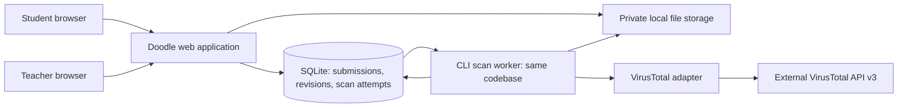

# Architecture and design baseline

## Intent and constraints

Extend Doodle with a durable, advisory scanning workflow while preserving submission and grading behavior. Four students share one repository. The agreed demo runs locally. PHP views, vanilla CSS/JavaScript, PDO and the existing auth model remain the baseline. Use PHP 8.3 and SQLite for the assessed local target; MySQL support is not claimed until separately exercised.

This document describes the architecture; the team record summarizes delivered contributions and validation records the scope of executed checks. See [baseline audit](final-project/step-c-performance-reliability-security-validation.md#baseline-verification) for inspected behavior and [scope](SRS.md) for requirements.

The [supported action matrix](SRS.md#cleanup-action-matrix) defines the public pages/routes. Assignment grading and student feedback are separate from file security advisories.

## Approaches considered

| Approach | Trade-off | Decision |
| --- | --- | --- |
| One LMS app and a background worker from the same codebase/database | Small deployment surface; worker and web app share schema/releases; scanning remains asynchronous | Selected by the coordinator |
| Separate scan service with an internal HTTP API | Independent process ownership and deployment; adds another auth/API/network boundary and operational setup | Rejected for this course scope |
| ESB or SOAP facade | Adds routing/contract infrastructure without another concrete protocol consumer | Rejected as unnecessary |

The worker is a second process, not an independently deployed microservice. The two integrated systems are the LMS and VirusTotal. Do not relabel the design to make the trends table appear more advanced.

## Context and components



- Controllers authorize and validate HTTP requests. They do not wait for provider completion.
- A submission service owns revision creation and schedules one durable automatic attempt in the same database transaction. Use scan-attempt rows as the initial database-backed work queue; do not also add Redis or a duplicate outbox.
- A CLI worker claims due attempts, performs provider steps and records progress. One worker is sufficient initially; claim leases and conditional writes prevent duplicate processing and support restart.
- A reusable `FileScanProvider` result interface isolates provider response interpretation. Both automatic and teacher-requested processing use it unchanged.
- The host application owns permissions, file storage, request scheduling and persistence. The adapter owns HTTP normalization and classification, with an injected transport for fixtures.
- Server-rendered views and a small same-origin status request expose only authorized normalized results. No browser talks directly to VirusTotal.

## Main sequence

```mermaid
sequenceDiagram
    actor Student
    participant Web as Doodle web app
    participant Store as Private file storage
    participant DB as SQLite
    participant Worker as Scan worker
    participant VT as VirusTotal
    Student->>Web: Submit synthetic attachment
    Web->>Web: Authenticate, authorize, validate
    Web->>Store: Store immutable revision; compute SHA-256
    Web->>DB: Transaction: revision + queued attempt + active pointer
    DB-->>Web: Commit
    Web-->>Student: Submission saved; scan pending
    Worker->>DB: Claim due attempt with lease
    Worker->>VT: Lookup hash; request new analysis or upload if absent
    VT-->>Worker: Analysis ID
    Worker->>DB: Persist analysis ID and next scheduled step
    Worker->>VT: Poll analysis; verify item/file identity
    VT-->>Worker: Completed evidence or failure
    Worker->>DB: Save result; update active advisory only if revision/attempt still current
    Student->>Web: Read authorized status
    Web->>DB: Load normalized current result
    Web-->>Student: Pending, advisory, or unresolved reason
```

## Failure and freshness rules

Saving submission data never depends on provider availability. A retryable failure schedules the next attempt step; it never sleeps inside a web request or adapter. If the process dies after the commit, the durable attempt is still discoverable. File writes are not part of a SQL transaction: remove the newly written file if its DB transaction fails, and never delete the old revision before the replacement is committed.

The current attempt is explicitly identified on each file revision. A new teacher rescan retains the previous completed result as history but the current view shows that a new check is pending. The submission's current revision pointer guards against late results from an older attachment. At-least-once work processing does not mean external scan-start requests are exactly once: an uncertain upload/rescan timeout is recorded, not blindly replayed as if provider hash deduplication guaranteed request idempotency.

Before a scan-start POST, persist an in-flight marker. If the worker crashes without saving an analysis ID, mark that attempt Unresolved on recovery rather than replay it. Once an ID is saved, persist a polling deadline; quota waits do not extend that deadline. See the exact recovery rules in `integrations.md` and `data-model.md`.

## Decisions and divergences

| ID | Decision / change | Reason and status |
| --- | --- | --- |
| D01 | Doodle; one app with worker; localhost | Coordinator selections. Deployment and schema complexity fit a four-person course project. |
| D02 | Database-backed attempts and expiring leases | Implemented durable due-work queries and short SQLite transactions support restart recovery. |
| D03 | Keep Technical 3 advisory meanings and separate job state from verdict | Earlier Technical 2 grouped suspicious findings with malicious and mixed processing labels with conclusions. |
| D04 | Preserve the narrow Technical 3 result interface; host owns start/upload/retry/persistence | Reuse without coupling the component to LMS sessions or SQL. |
| D05 | Hash lookup never masquerades as a new analysis | Known hash uses explicit re-analysis; absent hash uploads the synthetic file. Always persist the returned analysis ID. Verify account capability in a limited live smoke check. |
| D06 | Private revision storage and an authorized download endpoint | Upstream public URLs bypass the intended per-submission access boundary. |
| D07 | Synthetic data only; no production school rollout | External data-sharing restrictions and course demonstration scope. |
| D08 | No guaranteed 100 submissions/day or five-minute scan target | Request cost varies with polls, identity checks, failures and provider quota. Measure rather than reuse earlier estimates. |
| D09 | Conservative Technical 3 no-detection policy retained initially | Unsupported/failed engines yield Unresolved, potentially often. Measure the effect and record any future policy revision before changing semantics. |
| D10 | Cloud and containers are evaluated, not implementation requirements | Coordinator selected localhost. GitHub stores source; GitHub Pages cannot execute PHP. |
| D11 | Assignment-based teaching, submission and review | The supported public action map is enforced before controller loading. |
| D12 | Allocate work by module/file ownership and ordered handoffs | No contribution-size target. Baseline/shared contracts merge first; provider/worker, data, UI and HTTP/access use agreed boundaries. |
| D13 | Repair upstream startup, renderer and course/grade URLs; add a loopback router and writable local session directory | Implemented for localhost access and the written-submission-to-feedback baseline. No framework/runtime upgrade. Private file delivery and worker processing are verified separately in the current validation record. |

Builders may choose internal SQL/query organization and test harness details consistent with these contracts. Changes to public methods, state meanings, file access, external disclosure, provider budget or revision ownership require updating the shared design before dependent work is merged.

## Implementation reconciliation

The built system uses the selected single PHP application, SQLite revision/attempt repository, private storage and CLI worker. `ScanSubmissionService` commits uploads before asynchronous work; `ScanWorker` routes both origins through the shared adapter/result processor. Status polling and private downloads use authenticated existing routes. No queue broker, frontend framework, microservice, container or additional provider was introduced.

The reserved fixture analysis-handle namespace supplies durable demo provenance without a schema rewrite. Conservative engine classification and the explicit migration/version-1 schema remain unchanged. Existing private bytes are retained after metadata deletion for reviewed operator cleanup. Read-only reviews and connected fixture checks verify the implemented boundaries; live and performance evidence are separately recorded in validation.
