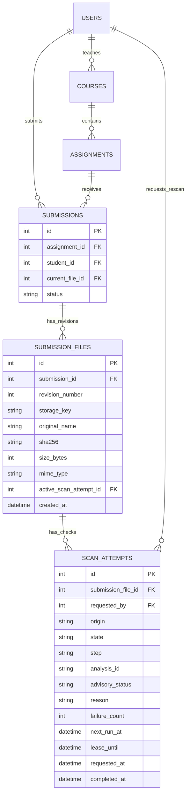
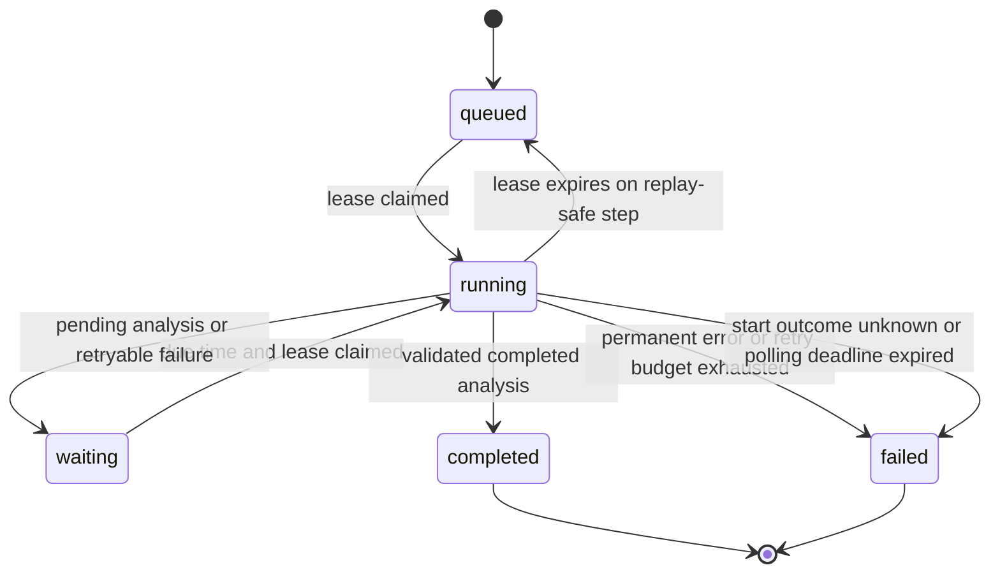

# Data model and states

Target schema additions; no migration has been applied. Reuse existing users, courses, assignments and submissions. Keep `submissions.status` for the existing academic workflow (`submitted` / `graded`); never write a scan verdict into it.

## ERD

## Ownership and constraints

`current_file_id` and `active_scan_attempt_id` are nullable pointers, set transactionally only to rows belonging to the same submission/revision. Validate this invariant in the service and tests; simple foreign keys alone do not enforce ownership across those pointers.

- `submission_files`: immutable file contents and identity; unique `(submission_id, revision_number)` and unique random `storage_key`. SHA-256 is indexed if useful, never unique across submissions. Use a 64-character lowercase hexadecimal representation. `original_name` is display-only, escaped on output; it is never a disk path.
- `scan_attempts`: `origin` is `automatic` or `teacher_rescan`; automatic has nullable `requested_by`, rescan requires an authorized actor. Add an `idempotency_key` (unique, server-issued per requested operation), `contract_version` (`1`), `stats_json` (nullable validated counts only), `last_http_code`, `updated_at`, and `lease_token` to the implemented migration. Index due work on `(state, next_run_at)`.
- `step`: `lookup`, `start`, `poll`, `verify`, or `persist`. Save step progress and analysis ID before yielding. Preserve enough evidence to resume polling without starting a second scan.
- Persist `start_in_flight` before sending upload/re-analysis POSTs. Save the returned analysis ID, `poll_deadline_at` (UTC, 30 minutes after that ID is stored) and cleared marker atomically. An expired lease with this marker and no analysis ID becomes `failed` with `Unresolved/start_outcome_unknown`; it is not replayed even if the crash may have occurred before bytes were sent. `scan_provider_state` is a separate singleton table for persisted shared budget reservations/counters and provider pause time, without credentials.
- `advisory_status` is nullable until evidence exists and thereafter uses the four exact public strings in [integrations](integrations.md#published-reusable-component). `reason` is a stable machine code; views map it to useful text.
- All stored application timestamps use UTC. Format local dates for users; durations use one clock/unit. Size is bytes; `retryAfter` is seconds.
- Existing `submissions.file_path`/`file_name` need a documented migration bridge. Backfill known local files into private revisions, verify counts, then switch all scoped readers. Never keep a public legacy download path as an access-control bypass.

## Processing state machine

`completed` means provider evidence processing finished; its advisory can still be `Unresolved` under the conservative policy. `failed` is a terminal workflow failure with advisory `Unresolved`. A new rescan creates another row; it does not mutate a terminal attempt back into queued. A text-only submission has no file revision and displays `Not applicable`, not a favorable scan outcome.

## Concurrency and migration acceptance

Allocate revision numbers and update current pointers within a transaction. Claim work through a conditional update with a unique lease token; accept the claim only when exactly one row changes. Persist results only while the token is owned. UI selection follows current pointers, not whichever result finished last. A stale worker may not overwrite another worker's state.

Test identical hashes on different submissions, a replacement arriving mid-scan, duplicate requests/jobs, lease expiry, two workers competing for a row, SQLite lock contention, and a failed file/DB write. Bound SQL transactions around state changes; never hold one across HTTP calls.

Recovery inspects `start_in_flight`, analysis ID and `poll_deadline_at` before requeueing. Quota waits before a scan starts can remain queued; once an ID exists, quota deferral does not extend the wall-clock polling deadline. An overdue attempt becomes `Unresolved/polling_exhausted` without another provider request.

Add new versioned forward migrations under `database/migrations/`; no existing migration runner is assumed. The implementation task must provide a repeatable runner and schema-version record. Do not rely on web requests silently applying project migrations. Fresh install and upgrade of a disposable baseline database both need proof. Backup/restore includes the database **and** private files.
