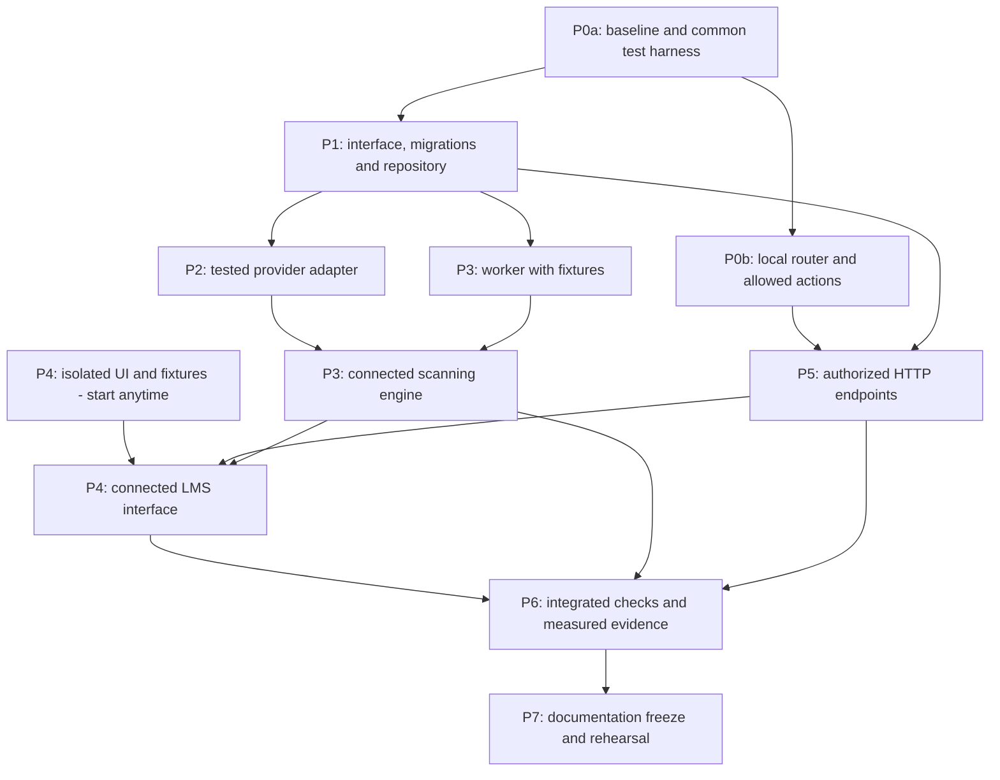

# Team guide: ownership, dependencies and prompting

Use these four workstreams as the assignment slots. Choose actual members by familiarity and availability, not commit counts or line counts. Names and any later reassignment are team decisions. Everyone reads the root README, AGENTS.md and the shared must-reads in [the documentation map](README.md).

Every member/agent must read [the SRS](SRS.md) before planning: it owns required final behavior. Use the complete UAT catalogue in [the demo/manual acceptance guide](demo-manual.md) to test supporting LMS features as well as scanning. The short panel script references those same cases but does not replace them. Record actual behavior, defects and retests; do not claim stakeholder acceptance from team rehearsal alone.

## Four assignments

| Member / workstream | Main tasks | Owns | Completion proof |
| --- | --- | --- | --- |
| 1: foundation and data | P0a, P1 | Baseline renderer/installer sweep; common test harness; forward migrations; immutable file revisions; submission/attempt repository; submission service and Student-controller seam | Reproducible core baseline, repeatable migrations, retained submissions and correct revision/attempt identity; passing baseline/persistence checks |
| 2: scanning engine | P2, P3 | VirusTotal adapter/transport; quota pacing; CLI worker; both automatic/rescan result consumers; provider fixtures | Same result contract in both workflows, correct classification, real provider evidence plus bounded failure/restart behavior; adapter/worker checks |
| 3: LMS interface | P4 | All student/teacher views and scan history/status partials; navigation/dashboards; styles/JS; display labels | Approved features remain usable, no quizzes/excluded links, understandable states, connected student-to-teacher-to-feedback journey; UI evidence |
| 4: HTTP, access and local delivery | P0b, P5 | Local serving/router and allowed actions; status/rescan/download endpoints; authorization/rescan service; local setup/access evidence | Correct JSON, authorized private downloads/rescans, direct excluded routes denied, another machine can follow setup; routing/status/access checks |

P6 validation and P7 final reconciliation/rehearsal involve **all four**. Each member tests/documents their own code. Select one coordinator to gather results, reconcile risks/AI-use records and merge the final release; this does not make that person responsible for writing everyone else's tests. Each owns the corresponding canonical guide: foundation -> data-model/architecture; scanning -> integrations; UI -> development; HTTP/access -> security/release. Request edits to shared scope, task plan, validation summary and AI/risk records through the coordinator rather than competing edits.

## What can start immediately?

The coordinator's localhost task added renderer/bootstrap and course/grade route repairs, the baseline test runner and local router. [README setup](../README.md#run-the-current-lms-on-localhost) is executable. After pulling this baseline, foundation/data continues the remaining attachment checks and P1; HTTP/access extends the existing router/tests for P0b's explicit action map and P5; UI can work from the repaired templates/header. Provider/worker work still consumes P1's pending interfaces. Do not repeat the completed renderer sweep or replace the shared test runner. Full P0 acceptance and second-machine reproduction remain open; see [the audit](baseline-audit.md). The table describes task dependencies, including preparation already completed here.

| Workstream | Can start now, without another member's implementation | Must wait for a handoff before connecting/merging |
| --- | --- | --- |
| Foundation/data | Reproduce baseline faults; implement P0a; plan migrations/repository and publish interface examples | Feature consumers wait for its common seam; P1 follows the core baseline sweep |
| Scanning | Study official API and shared contract; prepare harmless response fixtures; plan/write isolated adapter code against the published interface | Do not create a duplicate FileScanProvider. Executable shared checks need P0a harness and P1 interface; DB-backed worker needs P1 repository; live worker connection needs adapter and configured permitted account |
| UI | Inspect existing design; prepare new status/history partials, UI fixture examples and isolated scripts; plan the approved page list | Do not edit existing teacher templates while P0a changes grade links. Connect real status/rescan/download actions only after the HTTP contract is provided; end-to-end states also need the worker |
| HTTP/access | Map allowed/excluded actions and ownership checks; prepare new router/config/tests and endpoint design against shared JSON | Merge P0b after P0a; implement/connect DB-backed endpoints after P1. Coordinate route names/examples with UI before connection |

Preparation/new isolated files can proceed in parallel. A feature is not complete just because its dependency is faked. Report fixture-only work honestly and do not merge code that breaks main because its interface/runner is still absent.

## Handoff order

P0b and P1 can proceed in parallel after P0a because their owned files differ. Within scanning, implement/test the adapter before connecting the worker to it. Do not wait idle for a dependency: work on fixtures, isolated code/tests, review or your handoff documentation.

## Safe transfer to the next member

Send a PR/handoff containing: branch and revision; changed files; provided interface or JSON example; migration/config requirements; exact test commands and observed results; sanitized evidence; current limitations; which downstream task can now connect. Another member reviews it, then merge before consumers update from main. Do not copy chunks of another branch by hand or independently rename fields to make a local version work.

The base rendering sweep temporarily touches many controllers; finish and merge it first. After that, one owner edits each file. UI owns **both** student and teacher views; HTTP owns **all** scan endpoints; data owns SQL/repository; scanning owns provider/worker. If a missing method affects another owner, agree the contract and request the change there.

## How to use your AI agent

Give your agent a goal, your owned task IDs, relevant SRS requirement IDs, required reading and boundaries. Let it inspect the repository, identify assumptions and propose its own plan. Discuss the plan with it before implementation. You do not need a scripted sequence of follow-up prompts. Add the SRS and applicable UAT cases to any optional opener below; do not ask an agent to infer final requirements from a demo screenshot alone.

Useful follow-ups are evidence-focused: ask what existing code it can reuse, which dependency is missing, how it will test the failure path, what a proposed extra feature contributes to a demo scenario, and which exact checks passed. Use [the demo manual](demo-manual.md) as an end goal, not permission to omit required security/performance evidence.

Keep prompts scoped. Do not tell an agent to build the entire project when it owns one stream. Tell it when a dependency is not ready and ask it to use agreed fixtures without claiming live integration. Agent skills are optional tooling; repository contracts and the member's decisions remain authoritative.

## Optional starting prompts

### Member 1: foundation/data

> Read AGENTS.md, docs/README.md, docs/team-guide.md and the scope/architecture/data-model/integration contracts. My responsibility is the foundation/data stream, tasks P0a and P1. Inspect current code and reproduce the known blockers. Propose a minimal plan with tests and an early shared-contract handoff before writing code. Respect other owners, preserve approved supporting LMS features and exclude quizzes. I will discuss implementation choices with you. Use the demo scenarios as acceptance goals and report actual verification and downstream readiness.

### Member 2: scanning

> Read AGENTS.md, docs/README.md, docs/team-guide.md, docs/integrations.md and P2/P3 in the implementation plan. I own the scanning engine. Inspect what exists, then plan the smallest adapter/worker implementation with me. Use the published interface/repository and harmless fixtures; do not create competing SQL or edit HTTP/UI files. Distinguish work that can start now from work waiting on P1. Include timeout, quota, malformed-evidence and restart checks, and be explicit about fixture versus real provider proof.

### Member 3: interface

> Read AGENTS.md, docs/README.md, docs/team-guide.md, docs/feature-scope.md, docs/development.md and P4. I own all student/teacher presentation and shared navigation. Inspect existing views/styles and propose a minimal plan with me. Preserve approved LMS support, exclude quizzes and unrelated modules, and reuse the normalized status/rescan/download contracts. Begin isolated views with shared fixtures if endpoints are not ready. Do not reimplement backend classification or edit other owners' controllers. Use the demo manual to check the complete role workflow.

### Member 4: HTTP/access/local delivery

> Read AGENTS.md, docs/README.md, docs/team-guide.md, docs/security.md, docs/release.md, the integration contracts and P0b/P5. I own routing, authorized scan/rescan/download endpoints and local delivery. Inspect current paths and plan the smallest implementation with me. Coordinate with P0a/P1 before shared connection, use the published repository and JSON semantics, and do not change UI templates or add independent SQL. Test cross-user/course access, direct excluded actions, CSRF and private files; hand real endpoint examples and verification evidence to the UI owner.

These are optional openers, not complete implementation scripts. Members choose their approach with their agents within the shared contracts. Commit under the actual contributor's identity, never impersonate another member or add AI co-author credit; provide actual AI-use notes for the required disclosure.
