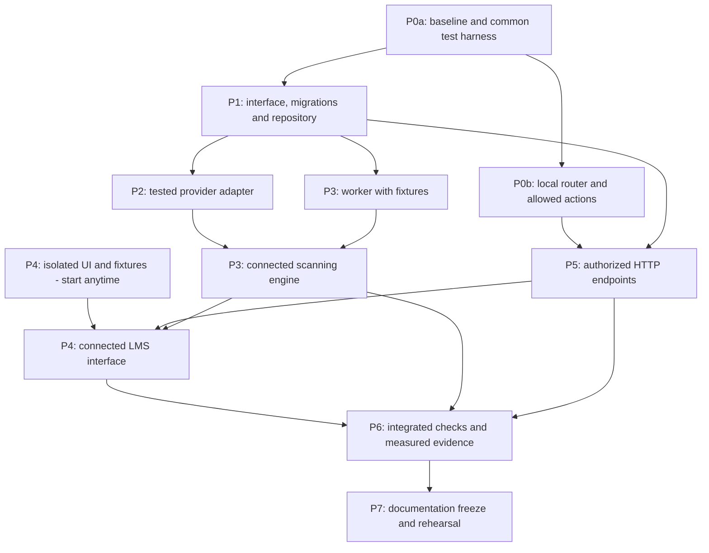

# Team plan and task record

Read your member row, dependencies and assigned P-task sections. The SRS owns product scope; architecture/data/integration guides own technical contracts. This file owns work division, task checks and completion. Claim Members 1-3 in the group chat; Member 4 is reserved. Use member numbers in repository docs.

## Ownership

| Member | Tasks and file ownership | Current state / dependency |
| --- | --- | --- |
| 1 — foundation/data | P1; migrations, immutable submissions/file revisions/attempts, repository/submission service, Student-controller seam, CLI/web bootstrap contract | Unclaimed. Baseline renderer/runner exists. Publish the data contract before connected consumers. |
| 2 — scanning engine | P2/P3; provider adapter/transport, quota pacing, CLI worker, both result consumers and provider fixtures | Unclaimed. Isolated adapter/fixtures can start; persistence-backed worker waits for P1. |
| 3 — LMS interface | P4; all student/teacher templates, status/history, polling, CSS/JS and shared navigation after initial cleanup | Unclaimed. Isolated partials/fixtures can start. Existing header/dashboard edits wait for P0b; connected UI waits for P3/P5. |
| 4 — HTTP/access/local delivery | P0b cleanup/action map and one-time menu/dashboard sweep; P5 status/rescan/history/private-download controllers, authorization and local delivery | Reserved. Replacement chat waits for explicit **continue**. Cleanup is NOT STARTED. Connected P5 waits for P1. |

P6/P7 are shared evidence/rehearsal gates. Each member supplies checks, docs and evidence for their code. Members use task branches and PRs; Member 4 reviews contracts/overlaps and integrates reviewed work. Ready for review is not Done. Full process rules are in AGENTS.md and its workflow file.

## Dependencies and parallel work

P0a is complete for installation/rendering and the written-submission journey. P0b and P1 can proceed independently because they own different files. Member 4 performs shared navigation/dashboard cleanup once, then returns those files to Member 3. Do not edit another owner's shared file concurrently.

Provider fixtures, isolated status partials, route/access planning and contract review can start before connected endpoints. Use fixtures honestly. P3 can exercise orchestration with P1 plus provider fixtures, then connect P2. P5 uses P1's exact repository/IDs/JSON; P4 connects to P3/P5. Missing dependencies mean Waiting for dependency, not competing SQL/interfaces.

P0b and P1 can proceed in parallel after P0a because their owned files differ. Within scanning, implement/test the adapter before connecting the worker to it. Do not wait idle for a dependency: work on fixtures, isolated code/tests, review or your handoff documentation.

## Handoff and prompting

Follow [fork synchronization](../.agents/rules/workflow.md#fork-synchronization) before starting/resuming a task, after a dependency merges and before submitting/updating its PR. Send the PR from your fork to the team main, with: branch and revision; changed files; provided interface or JSON example; migration/config requirements; exact test commands and observed results; sanitized evidence; current limitations; which downstream task can now connect. Another member reviews it, then merge before consumers connect. Do not copy chunks of another branch by hand or independently rename fields to make a local version work.

The baseline rendering sweep is complete. Request contract changes from their owner before updating dependent code.

Give your agent a goal, your owned task IDs, relevant SRS requirement IDs, required reading and boundaries. Let it inspect the repository, identify assumptions and propose its own plan. Discuss the plan with it before implementation. You do not need a scripted sequence of follow-up prompts. Add the SRS and applicable UAT cases to your starting prompt; do not ask an agent to infer final requirements from a demo screenshot alone.

Useful follow-ups are evidence-focused: ask what existing code it can reuse, which dependency is missing, how it will test the failure path, what a proposed extra feature contributes to a demo scenario, and which exact checks passed. Use [the demo manual](demo-manual.md) as an end goal, not permission to omit required security/performance evidence.

Keep prompts scoped. Do not tell an agent to build the entire project when it owns one stream. Tell it when a dependency is not ready and ask it to use agreed fixtures without claiming live integration. Use applicable installed skills as required by the workflow rules; repository contracts and the member's decisions remain authoritative.

One optional starting prompt is enough; members discuss solutions with their own agents:

> Read AGENTS.md and linked context. I own Member [number]'s tasks in docs/team-plan.md. Inspect current source/SRS, then plan only my assigned work with me. Respect file ownership and dependency gates; use agreed fixtures for independent preparation. Reuse existing code, write focused failure checks, report exactly what passed, and provide a PR with evidence and updated task records. Do not implement another member's stream or infer scope from screenshots.

## Review focus

1. A crash after provider acceptance but before local handle persistence must not replay scan start (P3).
2. A quota wait beyond the polling deadline must not silently extend it (P3).
3. A text-only update or rejected replacement must not lose the previous valid attachment or show the wrong advisory (P1/P4).
4. A direct static file URL must not bypass the authorized download action (P0/P5).
5. Changed component output or optional provider categories must affect both real consumers consistently (P2/P3).

## Implementation tasks

Only implement assigned tasks. Numerical policies remain in the contracts; do not independently rename IDs, fields or status meanings.

## P0: Make the scoped Doodle baseline reproducible

**P0a files (foundation first):** modify `app/core/Controller.php`, its rendering calls throughout `app/controllers/`, scoped teacher view links, `install.php`, `.gitignore`, `README.md`; create `tests/run.php`, `tests/BaselineTest.php`, `runtime-requirements.json` and `config/scan.example.php`. The runtime manifest/test files now exist; scan example configuration is still pending.

**P0b files (Member 4; next chat after continue, following P0a merge):** extend existing `app/core/Router.php`, `router.local.php` and routing tests; create `config/routes.php` for the final action map as needed. Own the initial header/navigation/dashboard cleanup before handing those files back to P4. Follow the exact SRS cleanup matrix. The explicit action map denies excluded controllers **and** quiz actions within retained controllers, rather than merely hiding links.

**Interfaces:** preserve public `*/view/{id}` actions; rename the protected rendering helper to `render(string $view, array $data = []): void` and update every internal `$this->view(...)` render call. Preserve `viewRaw`. Align teacher URLs/forms with existing `gradeSubmission(int $id)`. Define CLI-safe loading in P1 rather than requiring `index.php` from jobs.

- [x] Write controller-load checks for all 26 files, plus baseline installation and grade-route checks. The runner follows the discovery contract above and must throw/report nonzero without relying on PHP `assert()` settings.
- [x] Run `php tests/run.php --group=baseline`; observe the reproduced class conflict. Execute the installer in a disposable target to reproduce B07 before fixing bootstrap loading.
- [x] In P0a rename the common renderer/callers and repair grade links/forms and proven installer defects; ignore local sessions/install/migration flags and secrets/data. Verify and merge this baseline sweep before other streams edit controllers/templates.
- [x] Route aliases/class discovery/query links/page blockers and three-role navigation/guest/role checks reviewed in PR #1, merged at 8d15034 and verified on main (16 PHP checks plus JavaScript check). This is not final exclusion.
- [ ] Member 4 P0b next session, after continue: implement the final action map and initial navigation/dashboard cleanup from the [SRS cleanup matrix](SRS.md#cleanup-action-matrix). Extend routing tests to distinguish excluded routes from broken retained routes: block hidden/config/DB/private/docs/evidence paths; deny excluded modules/actions; preserve approved course/material/calendar/announcement/notification/profile/grading paths. Run `php tests/run.php --group=routing` plus direct-URL checks before merging.
- [x] Rerun baseline checks; verify login, enrollment, assignment view, written save, teacher review/grading and student feedback through a browser. Test direct protected paths under the actual router command. Attachment/replacement acceptance remains a separate open gate.
- [x] Add exact local dependency/setup commands to README/release guide, retaining unverified limitations. Commit only this repair task, with evidence; no scanning feature is implied by a green baseline.

**Acceptance:** BT01/BT02, UI02's retained-route smoke check and ST03/ST04 pass; a second member can reproduce installation. No quiz page/action is included in the target interface. Record additional scoped blockers rather than expanding into every upstream feature.

## P1: Establish revision, attempt and shared contract foundation

**Files:** create `database/migrations/001_scan_foundation.php`, `bin/migrate.php`, `app/scan/bootstrap.php`, `app/scan/FileScanProvider.php`, `app/scan/ScanSubmissionService.php`, `app/scan/ScanAttemptRepository.php`, `tests/ScanPersistenceTest.php`; modify web bootstrap and `StudentController.php` at the agreed service seam.

**Interfaces:** `ScanSubmissionService::saveFileRevision(int $submissionId, array $validatedUpload): int` accepts normalized keys `tmpPath`, `originalName`, `sizeBytes`, `mimeType` after PHP-upload validation; returns immutable revision ID. `ScanAttemptRepository::saveResult(int $attemptId, string $leaseToken, array $result, array $transition): bool` guards lease ownership and persists result/lifecycle atomically. Publish `FileScanProvider::getResult(string $analysisId, string $expectedSha256): array` exactly as specified. Host services receive PDO/private-root/clock explicitly; no session dependency in reusable component.

Freeze the additional repository contract in [integrations](integrations.md#shared-host-repository-contract) before handing off to scanning/HTTP work. The foundation stream owns submission/revision/attempt SQL; the scanning stream owns request-budget access to `scan_provider_state`. Do not create a second repository/parallel migration to resolve a consumer mismatch.

- [ ] Write failing tests for repeatable migrations, same hash across submissions, revision replacement, pointer ownership, one automatic attempt/revision, file-write and transaction failures, and text-only updates retaining the existing file.
- [ ] Run `php tests/run.php --group=persistence` and record the missing behavior failure.
- [ ] Implement forward migrations and runner, `scan_provider_state`, private immutable storage, transactional queued work, uniqueness and guarded persistence. Backfill scoped old files safely with count/hash evidence; validate actual upload errors/MIME/move result before success. Do not make provider calls.
- [ ] Rerun persistence tests; apply migrations twice on disposable DBs; verify no duplicates and old-file retention on a failed replacement. Update data-model/contract docs if practical details changed.
- [ ] Commit this shared seam and have its consumers reviewed before parallel dependent merges.

**Acceptance:** IT01/IT02 persistence portion and file-failure cases pass. Authenticated streaming is completed by P5 before release; no temporary public-storage workaround is acceptable.

## P2: Implement the reusable VirusTotal result adapter

**Files:** create `app/scan/VirusTotalAdapter.php`, `app/scan/CurlTransport.php`, `tests/ScanAdapterTest.php`, `tests/fixtures/virustotal/`; extend bootstrap explicitly.

**Interfaces:** implement P1's unchanged `FileScanProvider`; injected HTTP callable and four result fields follow `integrations.md`. Both analysis and item calls use the metered transport. Constructor receives server key and transport; no SQL/session/upload/retry loop.

- [ ] Write fixtures and failing checks for each CT01/CT02/CT03 case, nonnegative integer `retryAfter`, input rejection without HTTP, pending analyses, provider errors and file-identity mismatch.
- [ ] Run `php tests/run.php --group=adapter`; confirm missing/incorrect behavior fails.
- [ ] Implement fixed-origin verified TLS requests, ID encoding, strict required-schema checks, conservative normalized classification and sanitized failures. Additive provider fields are tolerated, required identities/counters are enforced.
- [ ] Rerun adapter tests without network/key. A new fixture/category must exercise the same adapter used by both callers; no mock classifier bypass.
- [ ] Publish tested component-consumption instructions/version and commit this task.

**Acceptance:** contract cases pass offline; raw provider shapes never escape as the public result. Recover/compare original Technical 3 PHP and AI artifact if available; record actual divergences.

## P3: Implement durable orchestration and the two real consumers

**Files:** create `app/scan/ScanWorker.php`, `app/scan/ScanProviderBudget.php`, `app/scan/AutomaticSubmissionResult.php`, `app/scan/TeacherRescanResult.php`, `bin/scan-worker.php`, `tests/ScanWorkerTest.php` and provider-start helper methods kept outside `FileScanProvider`.

**Interfaces:** `ScanWorker::runOnce(): bool` claims one due step. Both origin-specific consumers expose `process(int $attemptId, string $leaseToken): void` and use the same injected `FileScanProvider` plus P1 persistence. Start requests normalize to a new analysis ID; they do not change the reusable result interface. Entry point supports `--once`, fixture/live mode and graceful stop.

- [ ] Write failing tests for claim competition, bounded retries, rate budget including two-call result reads, auth pause, stored-handle restart, both real consumers, stale file/attempt results, start-in-flight crash and deadline-versus-quota behavior.
- [ ] Run `php tests/run.php --group=worker` against deterministic fake transport/clock; confirm failures before implementation.
- [ ] Implement lookup -> explicit fresh re-analysis or upload -> handle persistence -> poll/identity -> guarded result. Persist `start_in_flight` before POST; uncertain/crashed starts terminate Unresolved. Use due times, no adapter sleep; do not hold transactions during HTTP. Quota reservation tracks actual HTTP starts under persisted shared state.
- [ ] Rerun worker checks and crash/restart tests. Verify every VT request is counted; terminal/old results cannot replace current status. Measure queue recovery using fake delays, clearly labeled.
- [ ] Commit orchestration and update actual recovery/contract details in canonical docs.

**Acceptance:** CT04, IT03/IT04/IT05/IT06 and FT01-FT03 pass in fixtures. Provider and worker orchestration have one stream owner; contribution size is not an acceptance criterion.

## P4: Add the assignment-focused LMS interface and scan views

**Files:** create `app/views/scan/_status.php`, `app/views/scan/_history.php`, `public/js/scan-status.js`, `tests/ScanViewTest.php`, and UI fixtures under `tests/fixtures/status/`; maintain retained templates and modify student/assignment/teacher templates, shared header/navigation, dashboards, `app/helpers/functions.php` presentation helpers and styles as needed. No HTTP controller is owned by this task.

**Ownership:** Member 4 performs the initial menu/dashboard scope sweep in P0b; P4 receives those files after that merge.

**Interfaces:** consume IP09 status JSON and P5's rescan/download routes exactly as published; use fixture examples while endpoints are built. Own both student and teacher presentation to prevent competing edits to shared partials. Reuse one advisory formatter; never reclassify provider counts in JavaScript.

- [ ] Write failing view tests for pending/retry/completed/Unresolved, text-only not_applicable, replacement freshness, escaped long filenames and preserved form fields. Include approved menu destinations and absence of quiz/excluded links.
- [ ] Run `php tests/run.php --group=ui` and confirm failures.
- [ ] Implement student and teacher views including small scan history, grade/feedback and rescan form consuming P5 endpoints. Retain the approved course/material/calendar/announcement/notification/profile experience; remove excluded menu/dashboard links/counters without deleting shared helpers. Add active-only 15-second polling with hidden-tab pause, backoff and terminal stop; provider calls remain in the worker.
- [ ] Rerun view tests; check UI01/UI02 at narrow/wide widths, keyboard use and failed refresh. Smoke-test the retained teaching-to-feedback flow, including assignment-only gradebook content.
- [ ] Commit UI/status feature with screenshots and exact scenario results; update development guide.

**Acceptance:** UI01/UI02 pass for both student and teacher; P5 verifies actual endpoint authorization. No frontend framework or new navigation system.

## P5: Add teacher rescans, history and protected downloads

**Files:** create `app/scan/ScanAttemptService.php`, `app/controllers/ScanController.php`, `app/controllers/SubmissionFileController.php`, `tests/ScanAccessTest.php`, `tests/ScanStatusTest.php`; extend `Auth.php` only as needed and the task's P0b route/action map. Request template/link changes from P4 instead of editing its files concurrently. Use P1 repository methods rather than adding independent SQL.

**Interfaces:** `ScanAttemptService::requestRescan(int $submissionId, int $actorId, string $requestToken): array` returns `attemptId`, `created`, actual `processingState`; `ScanController::status(int $submissionId): void`; `ScanController::rescan(int $submissionId): void`; `SubmissionFileController::download(int $fileId): void`. Service authorizes and invokes P1's idempotent enqueue; it does not scan. Status JSON matches IP09; rescan returns 202 for created work, 200 for token replay. P3 handles the teacher-origin result consumer.

- [ ] Write failing checks for status JSON fields/unknown-status fallback, no-file not_applicable, owner/cross-course/admin scope, missing file, GET rescan rejection, invalid CSRF, duplicate token, authorized history and direct-path download bypass.
- [ ] Run `php tests/run.php --group=access`; confirm unauthorized cases fail before implementation.
- [ ] Implement authorized status/rescan/history access using the shared repository; publish real request/response examples to P4. Stream authorized private files as attachments; no caller-selected paths or public fallback. P4 renders the shared status/history templates.
- [ ] Run `php tests/run.php --group=status` and `php tests/run.php --group=access`; rerun ST01-ST04 and connected teacher UI paths. Prove a rescan obtains a new analysis ID under the worker; retrieving the old ID is not a fresh scan.
- [ ] Commit feature plus access-control evidence and documentation updates.

**Acceptance:** endpoints enforce object ownership, exact response semantics and approved action scope; both real processing call sites connect. Route map and endpoints have one stream owner; templates have another.

## P6: Run integration, performance, reliability and security experiments

**Files:** extend focused tests; add `tests/load/` runner using existing available tooling, sanitized outputs under `evidence/`; update `docs/final-project/step-c-performance-reliability-security-validation.md`, `docs/engineering.md` and `docs/final-project/step-a-working-integrated-system.md`.

**Interfaces:** consume the built system as documented; do not modify another task's contract silently to make a test pass.

- [ ] Run `php tests/run.php` and scoped role/browser acceptance; record actual failures and fix root causes in the owning task/PR.
- [ ] Run UI02/ST04: retained supporting LMS features work, all assessment links are assignment-only, and excluded direct URLs/actions are denied. Do not claim scope reduction from menu screenshots alone.
- [ ] Execute the full UAT01-UAT35 catalogue and variants from the demo manual, including supporting LMS features. Record actual results, Not run/Pass/Fail/Blocked, defects and retests in sanitized `evidence/uat/` records. The short DM01-DM13 panel script is not a substitute for this manual acceptance run.
- [ ] Execute the load ramp defined in `docs/final-project/step-c-performance-reliability-security-validation.md` against fake provider responses; report environment, variable, raw metrics, degradation point/tested bound and failure mode.
- [ ] Execute timeout, error, malformed-body and worker-crash trials; measure recovery including operator intervention where required.
- [ ] Perform LIVE01 once with permitted synthetic content, verifying real handle and item/hash relationship. No provider load test or real malware. Record fixture-versus-live distinction.
- [ ] Restore a disposable matched DB/private-file backup and have another member follow setup. Commit sanitized evidence and updated conclusions only.

**Acceptance:** R01-R09 and R15 have linked real evidence or an explicit unresolved failure. No fabricated performance or success claims.

## P7: Reconcile final artifacts and rehearse

**Files:** update canonical docs and final evidence manifest; preserve source artifacts/transcripts only after privacy review and with actual provenance.

- [ ] Reconcile supplied T1/T4, original component/transcript and historical RMMM with the built release; list any still-missing sources honestly.
- [ ] Update all register rows to implemented controls/retries/protocols; record divergences and their reasons.
- [ ] Add actual code/test/evidence links to both case lessons and all trend decisions.
- [ ] Complete each risk's final status, prediction-versus-outcome and reviewer/date; complete actual AI-use log.
- [ ] Have each member demonstrate their feature and explain one failure path; rehearse panel setup from a clean local target. Verify source revision and release contents before submission.
- [ ] Check FR01-FR27/NFR01-NFR12 traceability alongside R01-R15. Preserve unresolved manual defects and unexecuted checks honestly; do not convert a blocked feature into a claimed completed requirement to fit the demo slot.

**Acceptance:** all Parts A-F trace to the system as built. Remaining failures/risks are explicitly reported; final completion is not inferred from this planning document.

Use the SRS and full UAT catalogue as end-goal checks throughout implementation, not a last-day script. DM01-DM13 are the shorter presenter view of the same tested behavior. Any change outside SRS requirements, those cases or a concrete correctness/security need must be proposed before implementation. Use the prompting guidance above; members plan their own internal solutions with their agents rather than following a scripted conversation.

## Completion record

- [x] Documentation foundation, SRS, contracts/diagrams, team guide and full manual acceptance plan published.
- [x] Local installer/renderer/course/grade routes and sidebar selection repaired; localhost runbook and evidence published in `645a43a`.
- [x] Route/role/flashcard/demo-seeder follow-up reviewed, merged via [PR #1](https://github.com/ja2gc/lms-virustotal-integration/pull/1) and verified on main at `8d15034`. Owner: Member 4. Evidence: `evidence/baseline/routes-flashcards.json`.

- [x] Documentation consolidation — Done. Owner: Member 4; [PR #3](https://github.com/ja2gc/lms-virustotal-integration/pull/3), merged at `31e9424` and reverified on main. Reduced docs from 21 to 13, removed obsolete scope/index/handoff files, used member numbers and separated original Parts A-F. Read-only review corrections applied; 73 local links, all FR/NFR/R/P/RK/UAT IDs and unchanged technical contract blocks verified; `git diff --check` passed. Application files are unchanged. The replacement chat is a separate follow-up after publication and must wait for **continue**; feature cleanup is not started.

For every task/PR append: member number, task ID, branch/PR/merge, actual behavior/files, exact checks/results, sanitized evidence, contract/config/migration effects, downstream readiness and unresolved dependencies. Use Ready for review before integration; Done only after reviewed/merged verification. Update P-task checkboxes. Keep personal-name assignments in team communication.

- [x] Fork collaboration rules — Done. Owner: Member 4; [PR #5](https://github.com/ja2gc/lms-virustotal-integration/pull/5), reviewed, merged at `b4d80b9` and reverified on main. Added synchronization triggers, remote verification, preservation/divergence/conflict rules and fork-to-team PR flow; linked the agent entry, README and handoff guidance. Documentation only; feature cleanup remains not started. Verified 77 local links, preserved requirement/case IDs and technical contract blocks, no runtime-file changes and clean `git diff --check`.

The baseline route/flashcard/seeder follow-up is Done via PR #1/source merge 8d15034. It passed 16 PHP checks, the JavaScript check, 131 syntax checks and 145 links at that snapshot. Raw evidence remains under evidence/baseline/. Cleanup, private uploads and VirusTotal remain pending as the P-task checks show.
